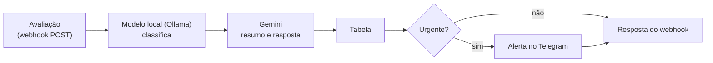

# Triagem de avaliações com n8n, Ollama e Gemini

Um restaurante de delivery recebe dezenas de avaliações por dia e precisa achar rápido as que exigem ação (uma alergia, um pedido que nunca chegou) no meio de elogios e sugestões. Este fluxo no n8n faz essa triagem sozinho: classifica cada avaliação, escreve uma resposta sugerida, guarda tudo numa tabela e avisa no Telegram quando algo é urgente.

**Resultado medido:** 88% de acerto de categoria contra um gabarito, e 100 avaliações triadas em 25 min sem ninguém na frente da tela, contra ~73 min fazendo à mão.

> Vídeo da demonstração em breve.

## Resultado

Medido com 100 avaliações fictícias e um gabarito de categorias ([detalhes](MEDICAO.md)):

| | Na mão | Fluxo, prompt v1 | Fluxo, prompt v2 |
| --- | --- | --- | --- |
| Categoria certa | 95% (18 de 19) | 65% (61 de 94) | **88% (87 de 99)** |
| Sugestões reconhecidas | n/a | 0 de 10 | **10 de 10** |
| Avaliações sem resposta | n/a | 6 | **1** |
| Tempo para 100 | ~73 min | 10 min | 25 min |

**Como saiu de 65% para 88%:** o primeiro prompt só listava os nomes das categorias. Comparando com o gabarito, os erros tinham padrão: toda avaliação que elogiava e sugeria virava "elogio", e "atendimento ótimo" virava reclamação de atendimento. Para cada padrão escrevi uma definição, uma regra de desempate ou um exemplo curto, sem trocar de modelo. As duas versões estão em [`prompts/1-classificacao.md`](prompts/1-classificacao.md).

**Por que a v2 levou mais tempo:** o plano gratuito do Gemini limita as chamadas por minuto. Sem pausa, 31 envios falharam. Com 4 s entre os envios e até 3 novas tentativas, falhou 1.

## Como funciona



**Entrada** (o que chega no webhook):

```json
{ "id": "A001", "nota": 2, "canal": "app",
  "texto": "Veio milkshake no lugar de pizza de calabresa. Tenho alergia, isso é perigoso." }
```

**Saída** (o que vai para a tabela e volta na resposta):

```json
{ "avaliacao_id": "A001", "categoria": "pedido_errado", "sentimento": "negativo", "urgencia": "alta",
  "resumo": "Cliente recebeu milkshake em vez de pizza e tem alergia.",
  "resposta_sugerida": "Pedimos sinceras desculpas pelo erro no seu pedido, entendemos o perigo da situação devido à sua alergia. Vamos entrar em contato o mais rápido possível para resolver isso." }
```

E no Telegram: `🚨 Avaliação urgente (pedido_errado): Cliente recebeu milkshake em vez de pizza e tem alergia.`

## Decisões

- **Dois modelos, duas tarefas.** Classificar é seguir regras, então fica com um modelo pequeno (llama3.2) rodando no próprio computador: sem custo por chamada e sem o texto do cliente sair da máquina. Escrever a resposta exige texto bom, então fica com o Gemini.
- **Categorias fechadas e saída só em JSON.** O modelo escolhe de uma lista, o que permite contar, comparar com o gabarito e ler os campos direto no próximo nó.
- **A IA sugere, a pessoa decide.** A resposta sugerida nunca promete reembolso, cupom ou desconto: isso custa dinheiro e fica com o dono.
- **Medir antes de afirmar.** As 100 avaliações de teste têm a categoria esperada em [`dados/gabarito.csv`](dados/gabarito.csv), e o script de envio calcula o acerto sozinho.

## Limitações e próximos passos

- **Urgência:** o modelo local ainda marca "alta" demais (64 de 99), sobretudo em atrasos simples, mesmo com a regra escrita no prompt. O próximo passo é calcular a urgência no nó Code com regras fixas ("alergia", "de novo", "não chegou") e deixar o modelo só com a categoria.
- **Confusões que sobraram:** pedido errado contra atendimento, e atraso contra atendimento (3 casos cada).
- **Dados fictícios:** as avaliações foram criadas para teste. Com avaliações reais, o acerto precisa ser medido de novo.

## Rodar

Precisa de [Node.js](https://nodejs.org) 18+, [Ollama](https://ollama.com) com `llama3.2` e uma chave gratuita do Gemini ([Google AI Studio](https://aistudio.google.com)).

1. `npx n8n` e abra http://localhost:5678.
2. Importe [`workflow/triagem-avaliacoes.json`](workflow/triagem-avaliacoes.json) (menu ⋯ → **Import from File**), cadastre as credenciais do Ollama, do Gemini e do Telegram, troque `SEU_CHAT_ID` pelo seu e publique. Para montar do zero, siga o [guia](GUIA.md).
3. Envie as 100 avaliações e veja o acerto:
   ```
   node scripts/enviar-avaliacoes.mjs http://localhost:5678/webhook/avaliacao
   ```

## Arquivos

| Caminho | O que é |
| --- | --- |
| [`workflow/triagem-avaliacoes.json`](workflow/triagem-avaliacoes.json) | O fluxo exportado do n8n, pronto para importar |
| [`GUIA.md`](GUIA.md) | Passo a passo para montar o fluxo no n8n |
| [`prompts/`](prompts/) | Prompts da classificação (v1 e v2) e da resposta, com o porquê de cada regra |
| [`dados/avaliacoes-ficticias.csv`](dados/avaliacoes-ficticias.csv) | 100 avaliações fictícias para teste |
| [`dados/gabarito.csv`](dados/gabarito.csv) | Categoria esperada de cada avaliação |
| [`scripts/enviar-avaliacoes.mjs`](scripts/enviar-avaliacoes.mjs) | Envia as avaliações ao webhook, mede o tempo e compara com o gabarito |
| [`MEDICAO.md`](MEDICAO.md) | Medição completa: na mão, prompt v1 e prompt v2 |

Feito por [Ian Santiago](https://github.com/ianeusantiago). Os prompts de outros projetos estão em [prompt-engineering](https://github.com/ianeusantiago/prompt-engineering).
