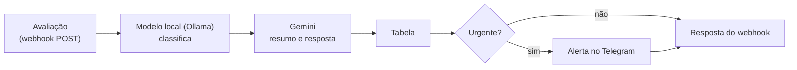

# Triagem de avaliações com n8n, Ollama e Gemini

Automação no n8n que faz a triagem das avaliações de clientes de um restaurante de delivery: um modelo local no Ollama classifica cada avaliação (categoria, sentimento e urgência), o Gemini escreve um resumo e uma resposta sugerida, tudo vai para uma tabela e os casos urgentes geram um alerta no Telegram.

> Projeto em construção. Os números de resultado entram depois da medição.

## Como funciona

- **Dois modelos, duas tarefas:** um modelo local segue regras fixas para classificar, sem custo e sem os textos saírem do computador; o Gemini escreve o texto. Os prompts estão em [`prompts/`](prompts/).
- **A IA sugere, a pessoa decide:** a resposta sugerida nunca promete reembolso ou cupom.
- **Medido com gabarito:** as 100 avaliações de teste têm a categoria esperada em `dados/gabarito.csv`, então dá para saber quantas o fluxo acertou.

## Arquivos

| Caminho | O que é |
| --- | --- |
| [`GUIA.md`](GUIA.md) | Passo a passo para montar o fluxo no n8n |
| [`prompts/`](prompts/) | Prompts da classificação e da resposta, com o porquê de cada regra |
| [`dados/avaliacoes-ficticias.csv`](dados/avaliacoes-ficticias.csv) | 100 avaliações **fictícias** para teste |
| [`dados/gabarito.csv`](dados/gabarito.csv) | Categoria esperada de cada avaliação |
| [`scripts/enviar-avaliacoes.mjs`](scripts/enviar-avaliacoes.mjs) | Envia as avaliações ao webhook, mede o tempo e compara com o gabarito |
| [`MEDICAO.md`](MEDICAO.md) | Resultado da medição: na mão contra o fluxo |

## Rodar

1. Monte o fluxo seguindo o [guia](GUIA.md) e ative o workflow.
2. `node scripts/enviar-avaliacoes.mjs http://localhost:5678/webhook/avaliacao`

As avaliações são fictícias, criadas para teste. Nenhum dado real de cliente é usado.
